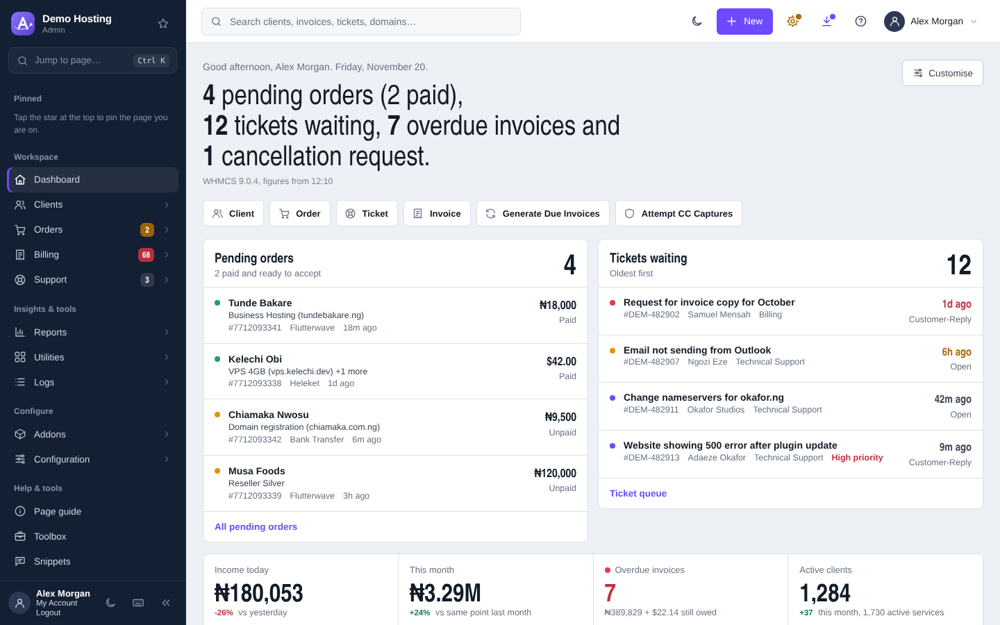
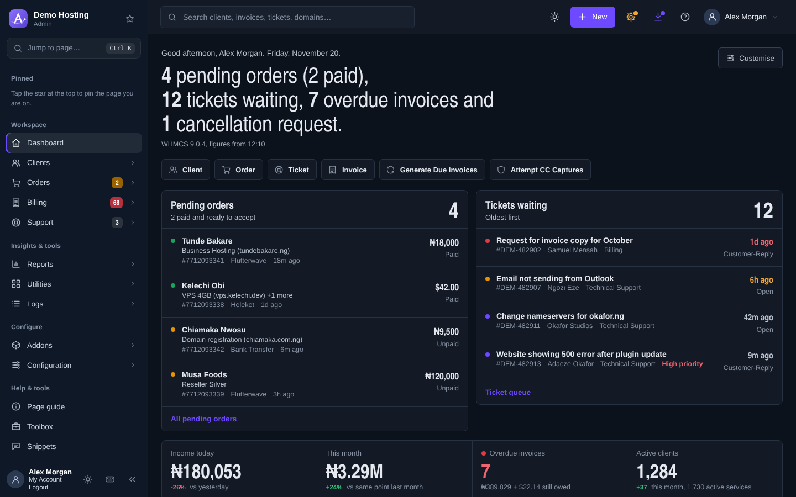
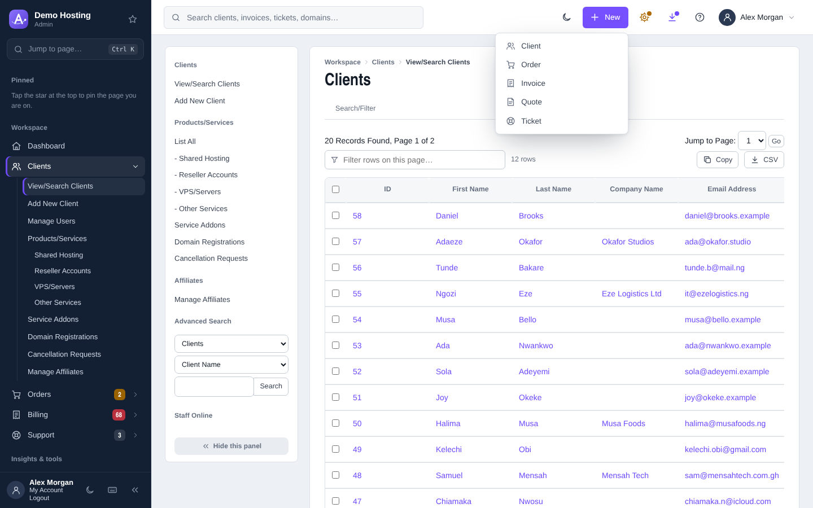
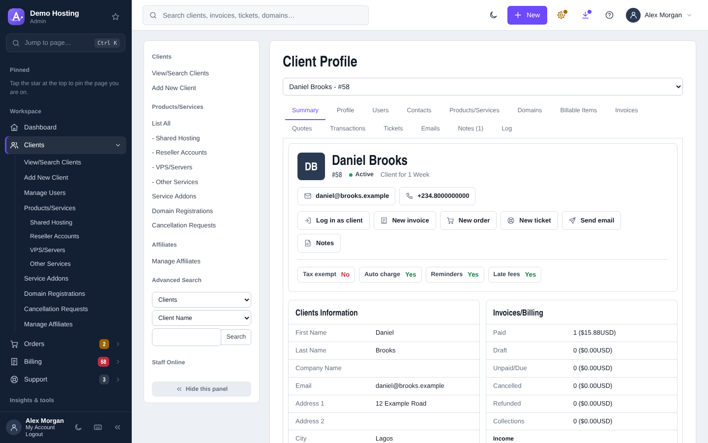
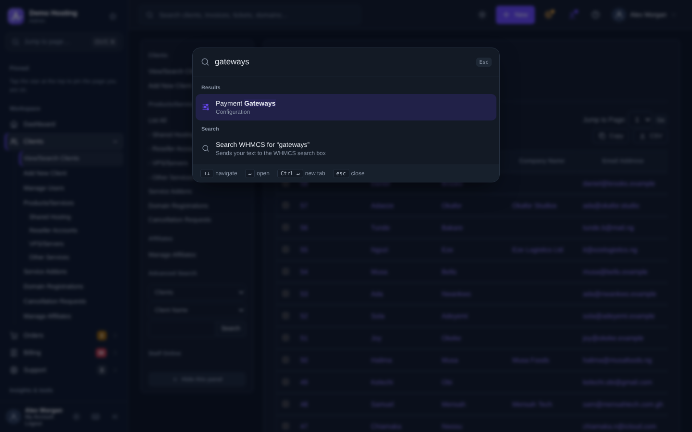
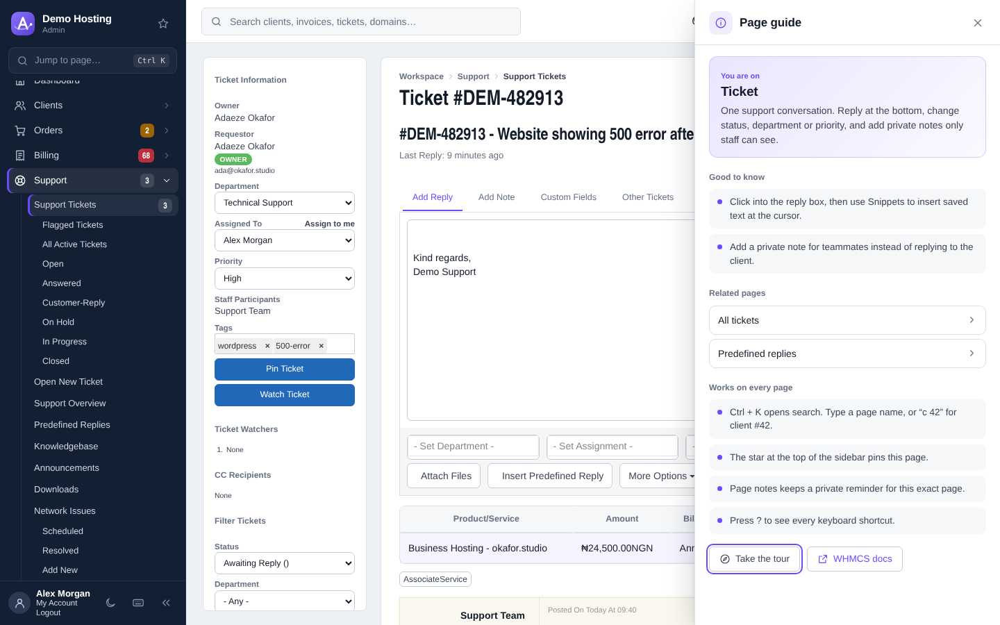
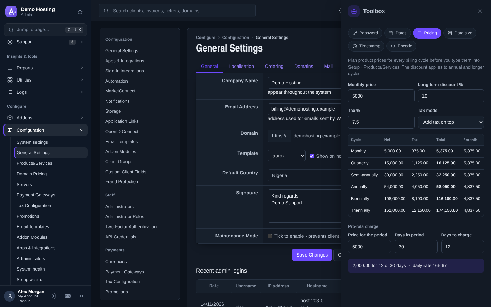
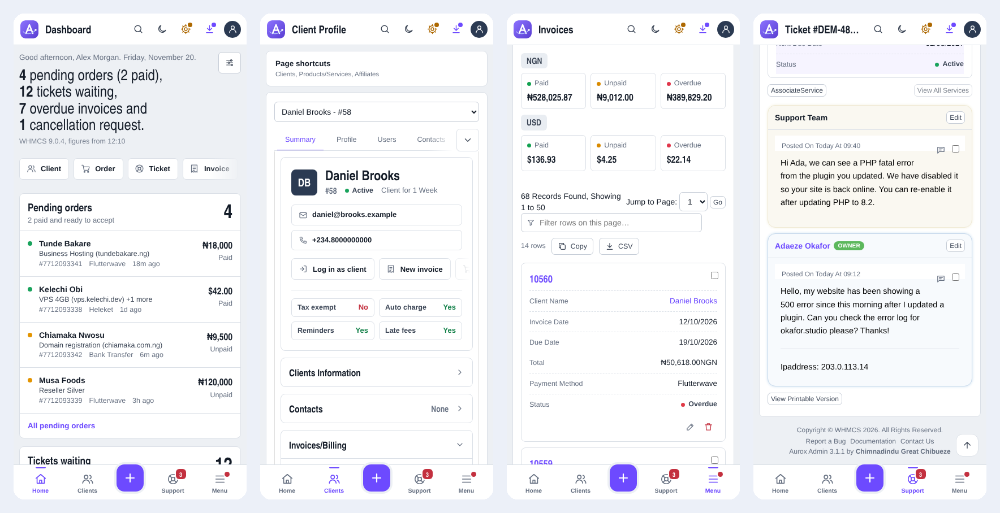
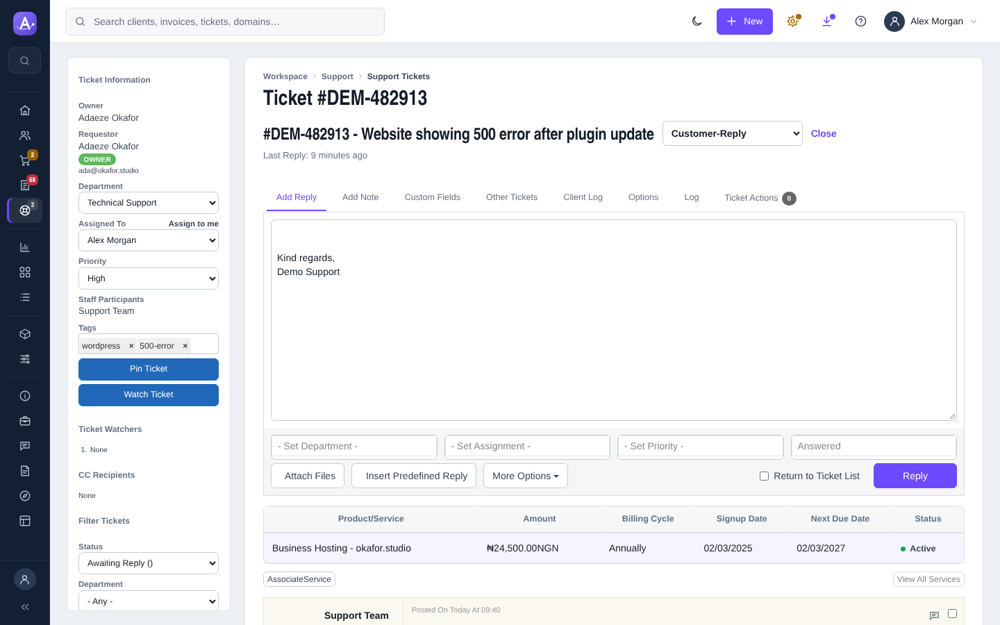
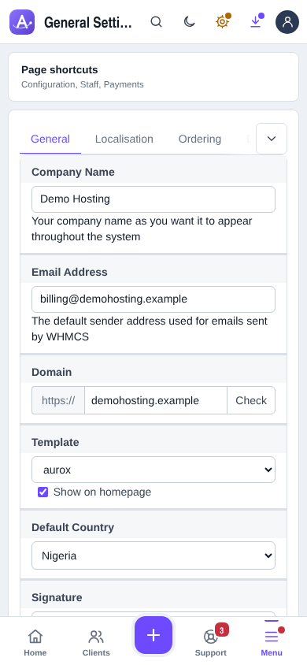

# Aurox Admin for WHMCS

   

I run a hosting company, so a big part of my day is spent inside the WHMCS admin area. It works, but finding your way around it is slow: menus inside menus, settings you only find if you already know where they are, and a lot of clicking just to open one invoice.

Aurox is the admin template I wanted to use every day. One clean menu with everything grouped by job, a top bar with search and quick actions, a dashboard that tells you what needs you, light and dark mode that cover every page, and helpful tools built in. It's simple enough that a new staff member can find their way around without being shown, and fast enough that you stop reaching for the mouse.



## What you get

**A dashboard that tells you what needs you.** Open WHMCS and the first thing you see is a greeting and one sentence: how many things need you today. Then, in order:

- **What's waiting on you:** pending orders (paid ones first, with what was ordered and the payment method) and tickets waiting for a reply (oldest first, with how long each customer has waited). One tap opens the order or ticket.
- **Key numbers:** income today (with a sparkline), this month against the same point last month, overdue invoices with the amount owed in each currency, and active clients.
- **Revenue chart** for the last 7, 14 or 30 days. Hover or tap any day to see what came in.
- **Also needs attention:** overdue invoices, cancellation requests, failed module actions, and domains pending or expiring soon.
- **Latest payments** and **recent orders**, then all of WHMCS's widgets below, restyled. Choose which show with **Customise**.

The live parts come from the companion addon (it only reads, and caches for a minute). Without it you still get the greeting, actions and WHMCS's widgets.



**One menu, everything in its place.** Every WHMCS area sits in a single left menu, grouped into *Workspace* (Dashboard, Clients, Orders, Billing, Support), *Insights & tools* (Reports, Utilities, Logs) and *Configure* (Addons, Configuration). The page you're on is always highlighted. Staff only see the links their admin role allows, just like the stock menu. Shrink it to icons when you want more room. On a phone it slides in from the side.

**A top bar with the things you reach for all day.**
- Search for clients, invoices, tickets and domains (this is WHMCS's own search, now front and centre)
- A **New** button for clients, orders, invoices, quotes and tickets
- Automation status, which turns orange or red when the cron needs attention
- Update notice, the Help menu and your account menu



**Client profiles at a glance.** Every client page opens with a header card: name, status, how long they've been a client, tap-to-email, tap-to-call, and one-tap actions (log in as the client, new invoice, new order, new ticket, send email, notes). Tax exempt, auto charge, overdue reminders and late fees are chips you click to switch.



**The page panel stays.** WHMCS shows useful details beside some pages, like a ticket's owner, department, status and tags. Aurox keeps that panel, restyled as a neat card next to the page. You can hide it when you don't need it, and on the dashboard it steps aside so the dashboard gets the full width.


**Jump to any page.** Press `Ctrl + K` (`⌘ + K` on a Mac, or just `/`) and type. "gateways", "email templates", "tax", whatever you need. You can also open records directly: `c 42` opens client #42, `i 1050` opens invoice #1050, and the same works for orders (`o`), tickets (`t`), services (`s`) and domains (`d`).



**A page guide on every page.** Not sure what a page is for? Press `I`. It explains the page in plain words, gives a couple of tips, and links to the pages people usually need next.



**A toolbox for the small jobs.** The things I used to open other websites for, now one click away:

- **Password generator** for new accounts and server logins (made in your browser, never sent anywhere)
- **Date calculator** for renewal and due dates
- **Pricing planner** that works out every billing cycle with discounts and tax, plus part-month (pro-rata) charges
- **Data size and transfer time** for disks, bandwidth and migrations
- **Timestamp converter** for the Unix times in logs
- **Encode and decode** for Base64, URLs, HTML and messy JSON



**Snippets and page notes.** Save the replies you type every day and drop them into a ticket reply where your cursor is. Keep private notes on any page or client ("call back Friday"), saved in your browser.

**Table tools.** Long tables get a filter box to narrow the rows on the page as you type, plus Copy and CSV download.

**It looks after you.** It warns you before you leave a form you haven't saved, and new admins get a short welcome tour the first time.

**Built for your phone too, on every page.** On a phone Aurox works like an app: a bottom tab bar (Home, Clients, Support, Menu) with a big **+** button for creating things, full-screen search, and a menu with one-tap shortcuts and your recent pages. Swipe the menu or the **+** panel away to close them. And every WHMCS page gets a layout that fits:

- Tables become easy-to-read cards, including WHMCS's DataTables (sorted and paged cards keep their labels), group headings and totals.
- Forms stack, invoice items and order items are editable cards, and ticket replies use the full width.
- Client profile sections fold open and closed, and remember how you left them. Long tab rows get a "Go to" list.
- Status words become coloured pills, and WHMCS's old icons are replaced with clean ones.
- Anything still wider than the screen is made to fit. **Help › Check page layout** tells you if a page fits and gives you a report to copy.



**Your look.** Light, dark or follow your device. Dark mode reaches WHMCS's own pages, widgets and forms too, not just the menu. Comfortable or compact spacing. Pin the pages you use most with the star at the top. One accent colour carries through the whole thing, logo included, so it matches your brand (the default is violet; set your own in `settings.tpl` or the addon).

| Collapsed menu | Settings form on a phone |
|---|---|
|  |  |

## Install

Full step-by-step guide with cPanel steps, updating and troubleshooting: **[INSTALL.md](INSTALL.md)**.

The short version:

1. In `admin/templates/`, copy the **blend** folder and name the copy **aurox**. This gives Aurox its own copy of WHMCS's core admin files (see why below).
2. Upload this repo's `admin/templates/aurox` files into that folder and overwrite.
3. In WHMCS, go to **Configuration › Administrators**, edit your user, and set **Template** to **aurox**.
4. Optional: upload `modules/addons/auroxadmin` and activate **Aurox Admin** under **Addon Modules** for live counters, a settings screen and one-click switching for your team.

### Why the copy step?

Aurox is a complete, standalone admin template: its own layout, menu, top bar, dashboard, styles and tools. But every WHMCS admin template also needs WHMCS's own core code: the admin JavaScript that powers ticket replies, client pages and pop-ups, plus WHMCS's page files. That code is owned by WHMCS and isn't allowed in a public repo. You already have it in Blend on your server, so you copy it once. After that, Aurox doesn't depend on Blend at all.

## Settings

| What | Where |
|---|---|
| Brand name, logo, colour, starting theme and spacing | `settings.tpl`, or the addon's settings screen if the addon is active |
| Dashboard shortcuts | `quicklinks.tpl` |
| Your own menu links | `menulinks.tpl` |

All three are in `admin/templates/aurox/`, and each one explains itself at the top. Personal things like light or dark mode, pins, snippets and page notes are saved in each admin's own browser.

## Updating

- **WHMCS update:** copy WHMCS's refreshed files from `blend` into `aurox` again. Leave out `header.tpl`, `footer.tpl`, `nav.tpl` and `homepage.tpl` so your Aurox files stay. Then empty WHMCS's template cache. [Exact steps](INSTALL.md#when-whmcs-releases-an-update).
- **Aurox update:** upload the new version over the old one, keeping your `settings.tpl`, `quicklinks.tpl` and `menulinks.tpl`, then empty WHMCS's template cache (Utilities › System › System Cleanup). [Exact steps](INSTALL.md#when-a-new-aurox-version-comes-out).

## If something goes wrong

Switch back to Blend from **Configuration › Administrators**, or with the addon's **Switch back to Blend** button. Locked out? Run this in phpMyAdmin (change the username):

```sql
UPDATE tbladmins SET template = 'blend' WHERE username = 'yourusername';
```

More fixes are in [INSTALL.md › Troubleshooting](INSTALL.md#troubleshooting).

## Keyboard shortcuts

Press `?` anywhere in the admin to see these.

| Keys | What happens |
|---|---|
| `Ctrl/⌘ + K` or `/` | Jump to a page |
| `G` then `D`, `C`, `O`, `I`, `T` | Dashboard, Clients, Orders, Invoices, Tickets |
| `G` then `S`, `R`, `,` | Services, Reports, Configuration |
| `N` then `C`, `O`, `T` | New client, new order, new ticket |
| `I` / `B` / `S` / `M` | Page guide / Toolbox / Snippets / Page notes |
| `[` | Shrink or expand the menu |
| `Ctrl/⌘ + Shift + L` | Light or dark |

## Making it your own

- **Menu:** `nav.tpl`. Each link is one line, with the same permission checks WHMCS uses.
- **Dashboard:** `homepage.tpl` holds the greeting, quick actions and widget layout.
- **Page guides:** the `GUIDE` list in `aurox/js/aurox-tools.js`. Add your own for pages your team uses a lot.
- **Colours and spacing:** CSS variables at the top of `aurox/css/aurox-admin.css`. To keep them safe across updates, override them in the addon's *Custom CSS* setting.
- **Dark mode for WHMCS's own boxes:** `aurox/css/aurox-dark.css` is generated by `tools/build-dark-css.py` from WHMCS's stylesheets. Re-run it after a big WHMCS release.
- **Icons:** after adding an icon to the scripts, run `python3 tools/build-icons.py` so the menu can use it too.

## What's in the repo

```
admin/templates/aurox/        Aurox's files (upload over your copy of blend)
├── header.tpl, footer.tpl    layout: menu, top bar, page panel, content
├── nav.tpl                   the menu
├── homepage.tpl              the dashboard
├── settings.tpl              brand, logo, colour, theme, spacing
├── quicklinks.tpl            your dashboard shortcuts
├── menulinks.tpl             your menu links
└── aurox/                    styles, dark mode, scripts, icons and logo
modules/addons/auroxadmin/    optional companion addon
tools/                        build scripts for the icon set and dark mode
docs/                         screenshots and an offline demo
INSTALL.md                    the full installation guide
```

## Security and privacy

- Every PHP file refuses to run if it's opened directly.
- The addon only *reads* from the WHMCS database, except when you click one of its template-switch buttons. Those are protected against cross-site requests, and only Full Administrators can switch everyone.
- It won't switch anyone to Aurox unless the template folder is complete, so nobody gets locked out.
- Settings are checked before they reach the page: colours must be real hex colours, links can't be `javascript:` links, and custom CSS can't break out of its style tag.
- Snippets, notes, pins and the toolbox run entirely in your browser. Nothing is sent to me or anyone else.

Found a security problem? Please read [SECURITY.md](SECURITY.md) instead of opening a public issue.

## Good to know

- The admin login page is shared by every admin template in WHMCS, so it keeps WHMCS's own design.
- Aurox changes the admin area only. Your client area theme isn't touched.
- Menu labels come from WHMCS's own language files, so they follow each admin's language.
- Some third-party addons hard-code white backgrounds, so you may see the odd light patch in dark mode. Tell me which one and I'll cover it.
- The screenshots come from a test render with sample data. A real install shows your own data.

## Contributing

Ideas, bug reports and pull requests are welcome. Have a look at [CONTRIBUTING.md](CONTRIBUTING.md) first; it's short.

## Credits

Designed and built by **Chimnadindu Great Chibueze**, founder of AuroxHost.

- GitHub: [@GreatsLab](https://github.com/GreatsLab)
- X: [@JustDeGreat](https://x.com/JustDeGreat)
- LinkedIn: [chimnadindu](https://www.linkedin.com/in/chimnadindu)
- WhatsApp channel: [Aurox updates and tips](https://whatsapp.com/channel/0029VbE0FCREKyZAE4SW1u3H), follow it to hear about new versions first

If Aurox makes your day in WHMCS a little easier, a star on the repo means a lot.

## License

MIT, see [LICENSE](LICENSE). Use it, change it, share it.

WHMCS is a trademark of WHMCS Limited. This project isn't made by or affiliated with WHMCS. As WHMCS requires, the WHMCS copyright notice stays in the footer.
