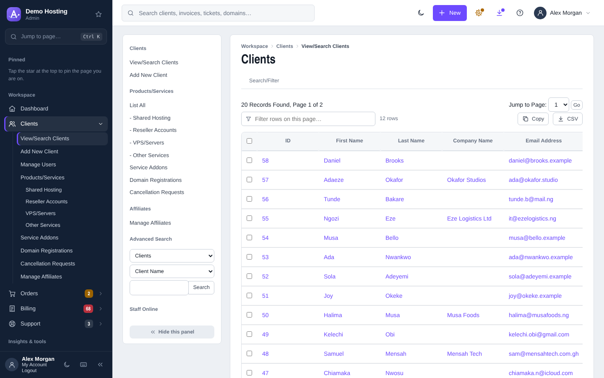
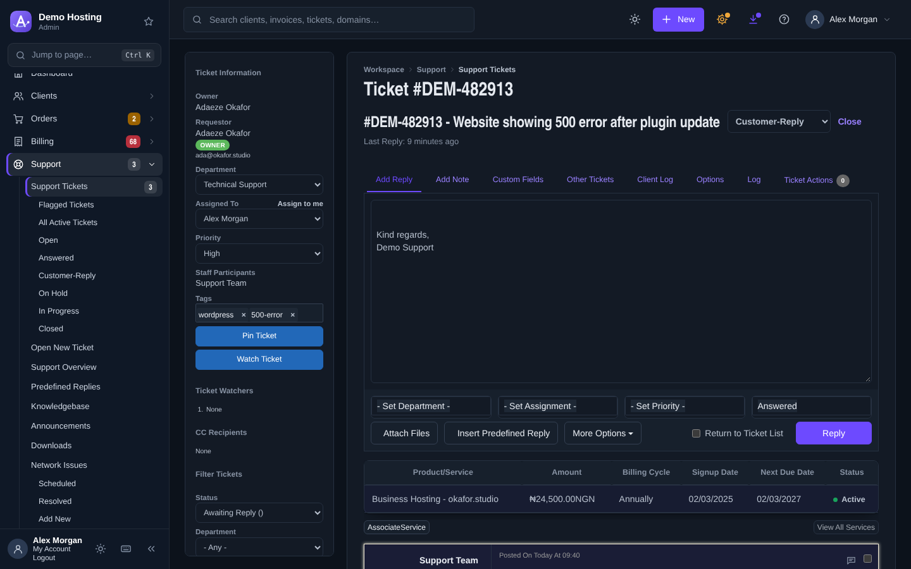

# Aurox Admin for WHMCS

  

I run a hosting company, so a big part of my day is spent inside the WHMCS admin area. It works, but finding your way around it is slow: menus inside menus, settings you only find if you already know where they are, and a lot of clicking just to open one invoice.

Aurox is the admin template I wanted to use every day. One clean menu with everything grouped by job, a top bar with search and quick actions, and helpful tools built in. It's simple enough that a new staff member can find their way around without being shown, and fast enough that you stop reaching for the mouse.



## What you get

**One menu, everything in its place.** Every WHMCS area sits in a single left menu, grouped into *Workspace* (Dashboard, Clients, Orders, Billing, Support), *Insights & tools* (Reports, Utilities, Logs) and *Configure* (Addons, Configuration). The page you're on is always highlighted. Staff only see the links their admin role allows, just like the stock menu. Shrink it to icons when you want more room. On a phone it slides in from the side.

**A top bar with the things you reach for all day.**
- Search for clients, invoices, tickets and domains (this is WHMCS's own search, now front and centre)
- A **New** button for clients, orders, invoices, quotes and tickets
- Automation status, which turns orange or red when the cron needs attention
- Update notice, the Help menu and your account menu


**The page panel stays.** WHMCS shows useful details beside some pages, like a ticket's owner, department, status and tags. Aurox keeps that panel, restyled as a neat card next to the page. You can hide it when you don't need it.



**Jump to any page.** Press `Ctrl + K` (`⌘ + K` on a Mac, or just `/`) and type. "gateways", "email templates", "tax", whatever you need. You can also open records directly: `c 42` opens client #42, `i 1050` opens invoice #1050, and the same works for orders (`o`), tickets (`t`), services (`s`) and domains (`d`).


**A page guide on every page.** Not sure what a page is for? Press `I`. It explains the page in plain words, gives a couple of tips, and links to the pages people usually need next.


**A toolbox for the small jobs.** The things I used to open other websites for, now one click away:

- **Password generator** for new accounts and server logins (made in your browser, never sent anywhere)
- **Date calculator** for renewal and due dates
- **Pricing planner** that works out every billing cycle with discounts and tax, plus part-month (pro-rata) charges
- **Data size and transfer time** for disks, bandwidth and migrations
- **Timestamp converter** for the Unix times in logs
- **Encode and decode** for Base64, URLs, HTML and messy JSON


**Snippets and page notes.** Save the replies you type every day and drop them into a ticket reply where your cursor is. Keep private notes on any page or client ("call back Friday"), saved in your browser.

**Table tools.** Long tables get a filter box to narrow the rows on the page as you type, plus Copy and CSV download.

**It looks after you.** It warns you before you leave a form you haven't saved, and new admins get a short welcome tour the first time.

**Your look.** Light, dark or follow your device. Comfortable or compact spacing. Pin the pages you use most with the star at the top. One accent colour carries through the whole thing, so it matches your brand.

| Phone | Collapsed menu | Shortcuts (`?`) |
|---|---|---|
|  |  |  |

## Install

You need WHMCS 8 and PHP 7.4 or newer. Keep WHMCS's built-in **Blend** template in place (it ships with WHMCS, and Aurox uses it behind the scenes).

1. Download the latest zip from the [Releases page](https://github.com/GreatsLab/aurox/releases), or clone this repo.
2. Upload the `admin/templates/aurox` folder into your WHMCS admin folder, so you end up with `admin/templates/aurox/header.tpl`. If you renamed your admin folder, use that name instead of `admin`.
3. In WHMCS, go to **Configuration › Administrators**, edit your admin user, set **Template** to **aurox**, and save.

That's it. Refresh and you're in.

### Optional: the companion addon

The template works on its own. The small companion addon adds:

- **Live counters** in the menu: pending orders, overdue and unpaid invoices, tickets waiting for a reply, cancellation requests
- A **settings screen** inside WHMCS (brand name, logo, colour, extra menu links and more)
- One-click **"Use Aurox for everyone"** and **"Switch back to Blend"** buttons

To add it, upload `modules/addons/auroxadmin` to your WHMCS folder, then go to **Configuration › System Settings › Addon Modules**, activate **Aurox Admin**, and tick the admin roles that may use it.

## Settings

**Without the addon:** open `admin/templates/aurox/settings.tpl` in any text editor. It has five clearly marked settings (brand name, logo, colour, starting theme and spacing). Change the values in quotes and save.

**With the addon:** use **Configuration › System Settings › Addon Modules › Aurox Admin › Configure**. These settings take over from `settings.tpl`.

Personal things like theme, pins, snippets and notes are saved in each admin's own browser.

## Updating

**When you update WHMCS:** you don't need to do anything. Aurox uses WHMCS's own page files and scripts live from the Blend template, so it picks up WHMCS's changes automatically.

**When a new Aurox version comes out:** upload the new `aurox` folder over the old one. Keep a copy of your `settings.tpl` first, or use the addon so your settings live inside WHMCS.

## How it works (and why it survives WHMCS updates)

Aurox is a *child template*. It brings its own layout, menu, top bar, styles and tools. The heavy WHMCS-specific parts, like the client summary page, the ticket view and WHMCS's core JavaScript, come live from the Blend template that every WHMCS install already has. Each of those files in Aurox is a single line pointing at Blend's version.

That's why you never have to reinstall after a WHMCS update, and why this repo contains none of WHMCS's own code, so it can be shared freely on GitHub.

## If something goes wrong

Switch back to Blend from **Configuration › Administrators** (set Template back to **blend**), or with the companion addon's **Switch back to Blend** button.

If you can't reach the admin area at all, run this in phpMyAdmin (change `yourusername`):

```sql
UPDATE tbladmins SET template = 'blend' WHERE username = 'yourusername';
```

Then please [open an issue](https://github.com/GreatsLab/aurox/issues) with your WHMCS version and what you saw, so I can fix it.

## Keyboard shortcuts

Press `?` anywhere in the admin to see these.

| Keys | What happens |
|---|---|
| `Ctrl/⌘ + K` or `/` | Jump to a page |
| `G` then `D`, `C`, `O`, `I`, `T` | Dashboard, Clients, Orders, Invoices, Tickets |
| `G` then `S`, `R`, `,` | Services, Reports, Configuration |
| `N` then `C`, `O`, `T` | New client, new order, new ticket |
| `I` / `B` / `S` / `M` | Page guide / Toolbox / Snippets / Page notes |
| `[` | Shrink or expand the menu |
| `Ctrl/⌘ + Shift + L` | Light or dark |

## Making it your own

- **Menu:** `admin/templates/aurox/nav.tpl`. Each link is one line, with the same permission checks WHMCS uses.
- **Page guides:** the `GUIDE` list in `aurox/js/aurox-tools.js`. Add your own for pages your team uses a lot.
- **Colours and spacing:** CSS variables at the top of `aurox/css/aurox-admin.css`. To keep them safe across updates, override them in the addon's *Custom CSS* setting instead of editing the file.
- **Icons:** the icon set lives in the two JavaScript files. Run `python3 tools/build-icons.py` after adding one so the menu can use it too.

## What's in the repo

```
admin/templates/aurox/        the template (upload this)
├── header.tpl, footer.tpl    layout: menu, top bar, page panel, content
├── nav.tpl                   the menu
├── settings.tpl              your settings when not using the addon
├── *.tpl, affiliates/*.tpl   one-line links to WHMCS's own page files
└── aurox/                    Aurox's styles, scripts, icons and logo
modules/addons/auroxadmin/    optional companion addon
docs/                         screenshots and an offline demo (preview.html)
tools/build-icons.py          keeps the menu icons in sync with the scripts
```

## Security and privacy

- Every PHP file refuses to run if it's opened directly.
- The addon only *reads* from the WHMCS database, except when you click one of its template-switch buttons. Those are protected against cross-site requests, and only Full Administrators can switch everyone.
- It won't switch anyone to Aurox unless the template folder is complete, so nobody gets locked out.
- Settings are checked before they reach the page: colours must be real hex colours, links can't be `javascript:` links, and custom CSS can't break out of its style tag.
- Snippets, notes, pins and the toolbox run entirely in your browser. Nothing is sent to me or anyone else.

Found a security problem? Please read [SECURITY.md](SECURITY.md) instead of opening a public issue.

## Good to know

- The admin login page is shared by all admin templates in WHMCS, so it keeps WHMCS's own design.
- If a future WHMCS version adds a brand-new page file to Blend, Aurox needs a one-line file pointing at it. I'll ship those in updates, and you can add one yourself in the meantime (copy any of the one-line `.tpl` files and change the name).
- Some third-party addons hard-code white backgrounds, so you may see the odd light patch in dark mode.
- The screenshots in this README come from a test render with sample data. Your own data and WHMCS's wording appear on a real install.

## Contributing

Ideas, bug reports and pull requests are welcome. Have a look at [CONTRIBUTING.md](CONTRIBUTING.md) first; it's short.

## Credits

Designed and built by **Chimnadindu Great Chibueze**, founder of AuroxHost.

- GitHub: [@GreatsLab](https://github.com/GreatsLab)
- X: [@JustDeGreat](https://x.com/JustDeGreat)
- LinkedIn: [chimnadindu](https://www.linkedin.com/in/chimnadindu)

If Aurox makes your day in WHMCS a little easier, a star on the repo means a lot.

## License

MIT, see [LICENSE](LICENSE). Use it, change it, share it.

WHMCS is a trademark of WHMCS Limited. This project isn't made by or affiliated with WHMCS. As WHMCS requires, the WHMCS copyright notice stays in the footer.
